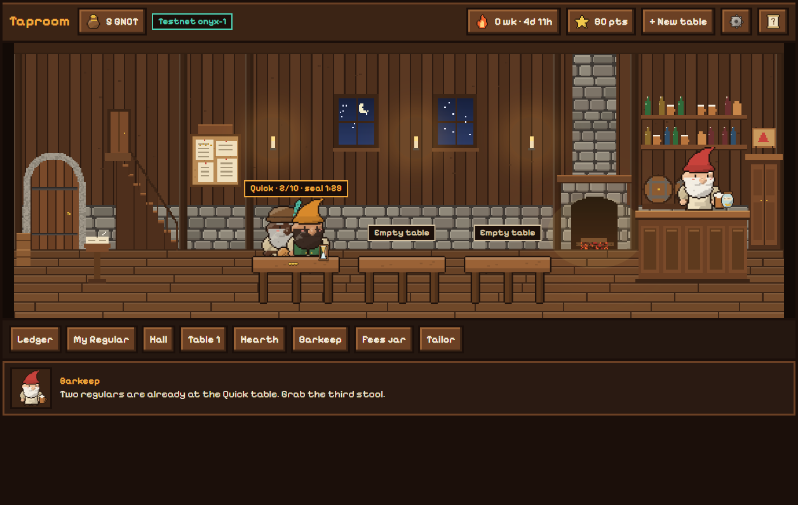
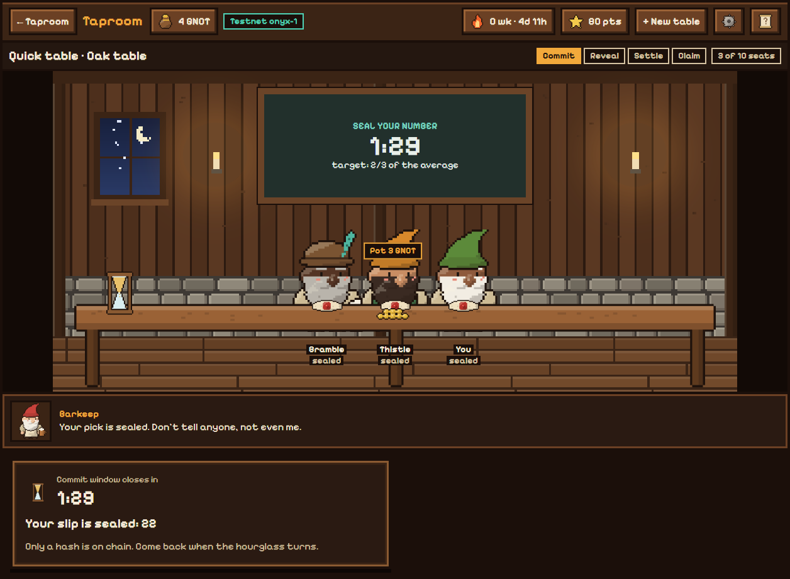
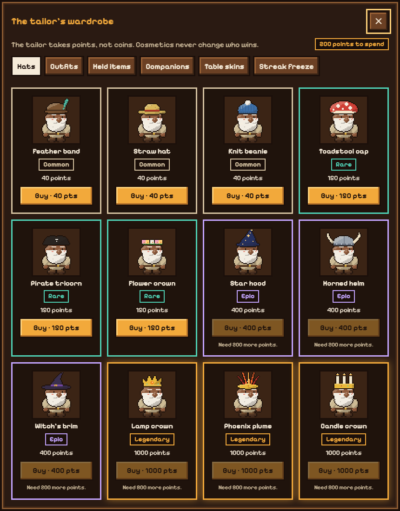

# Taproom

A pixel-art tavern of short mind games on [Gno.land](https://gno.land). Players sit at a table, seal a number, and the one closest to two thirds of the crowd's average takes the pot. Every place in the room is a feature: the tables are games, the hearth keeps your weekly streak, the notice board holds the leaderboards, and the tailor sells costumes for your gnome.

Taproom is an entry for the Gnome Tavern Hackathon. It is a community project with no official link to Gno.land or its team.

**Play it at [taproom.arifintahu.com](https://taproom.arifintahu.com):**

- [taproom.arifintahu.com](https://taproom.arifintahu.com) plays for real on the Onyx testnet with the [Adena](https://www.adena.app) wallet. Get test GNOT from the [Onyx faucet](https://faucet.gno.land).
- [taproom.arifintahu.com/?chain=mock](https://taproom.arifintahu.com/?chain=mock) opens the tavern on a simulated chain: no wallet, no coins.
- [taproom.arifintahu.com/?dev](https://taproom.arifintahu.com/?dev) runs the simulated chain with the demo toolbar and guided scenarios (win, lose, forfeit, tie, cancelled round, streaks, the shop and more).



## Gameplay

### The 2/3 Game

Each table runs one round of the classic "guess two thirds of the average" game, with real coins at stake and nothing hidden from the chain.

1. **Seal.** Pay the 1 GNOT entry fee and write a whole number from 0 to 100 on your slip. Only a hash of your pick goes on chain, `sha256("<round>:<your address>:<pick>:<salt>")`, so nobody can see it, not even the tavern. The round and your address are part of the hash, so a copied hash is useless to anyone else. The app keeps the salt in your browser; back it up from the Ledger.
2. **Reveal.** When the hourglass turns, break your seal. The realm checks your pick against the hash. Miss the reveal window and your deposit stays in the pot.
3. **Settle.** When the reveal window closes, anyone can settle the round, visitors included. The winner is the revealed pick closest to two thirds of the average of all revealed picks.
4. **Claim.** Winners claim their share. Payouts are pull-based: settling credits a balance, and claiming sends the coins.



### The rules in numbers

| Rule | Value |
|---|---|
| Entry fee | 1 GNOT per player |
| Players per table | 2 to 10 (best with 3 or more) |
| Tavern fee | 0.5% of the pot, only on completed rounds |
| Ties | The prize splits evenly; the remainder goes to the first winner in join order |
| No reveal | The deposit stays in the pot for the winner |
| Fewer than 2 reveals | The round is cancelled and everyone is refunded in full, with no fee |
| Windows | Quick 2 + 2 minutes, Standard 30 + 30 minutes, Daily 12 + 12 hours |
| Open tables | Up to 3 per player at a time |

With exactly two players the lower pick always wins (two thirds of the average is one third of the sum), and the table says so. Groups that play together drift toward 0 over time, which is part of the fun of guessing the crowd.


### Before you sign

Every action that writes to the chain first opens the tavern's Confirm sheet: the action, the amount, the recipient realm, and for a join the pot, the 0.5% fee and what the winner would receive. On a real chain it also shows the network fee (the gas fee the dev key offers, or "set by Adena") and that the chain charges a storage deposit for the data the call writes. Only **Approve and sign** passes it to the wallet.


### Points, ranks and the weekly streak

- **Points:** 10 for revealing in a completed round, 30 for a win, plus your streak bonus. Points are cosmetic: they cannot be traded and never change who wins. Void rounds pay no points.
- **Ranks** by lifetime points: Newcomer 0, Regular 100, Sharp 500, Oracle 1500, Legend 4000.
- **Weekly streak:** reveal in at least one round each week (weeks start Monday 00:00 UTC). The bonus per round is 4 points per streak week, up to 20.
- **Ember jars (streak freezes):** 40 points each, at most 2. Each covers one missed week automatically. Miss more weeks than you hold and the streak resets, using up every jar.


### The tailor's wardrobe

Spend points on 48 items across four slots (hat, outfit, held item, companion), from Common (40 points) to Legendary (1000 points), and on table skins that everyone at your table sees. The Hall shows leaderboards for net coins, sharpest guesses, longest streak and points, plus a gallery sorted by style.



### Practice first

The Barkeep runs a free practice round against five scripted regulars: no wallet, no coins, about 20 seconds, ending with the same chalk tally as a real round.


On narrow screens the room scrolls sideways and the Places row below it reaches every destination. Every place in the room is a real button, so the whole game works with a keyboard and a screen reader. Reduce motion turns the fire, flips and pulses into fades.

## How it is built

```
taproom/
  realm/commitreveal/  Gno package: the commit-reveal lifecycle for any sealed choice (importable)
  realm/avatar/        Gno package: the pixel gnome as SVG, with equipped items (importable)
  realm/taproom/       Gno realm: rounds, stakes, payouts, points, streaks, freezes, cosmetics, JSON views
  realm/sealedpoll/    Gno realm: sealed polls, a second realm built on commitreveal
  realm/scripts/       local gnodev chain: start, deploy, fund test keys, play scripted regulars
  web/             Vite + React + TypeScript app
    src/game/      rules and settle maths, streak, catalogue, avatars, selectors, scene layout
    src/chain/     ChainClient interface: MockChain (scenarios) and GnoChain (qeval reads, wallet signers)
    src/scene/     the room and the table close-up, drawn as DOM layers with real buttons
    src/ui/        HUD, Barkeep, windows, Confirm sheet, chalk slate
    src/dev/       dev mode: scenarios S1-S13, guided steps and the simulation toolbar
  tools/pixelart/  the Python generator for all the pixel art in web/public/pixel
  tools/verify/    standalone settle checker: recomputes any round from chain data
  media/           README screenshots (regenerate with pnpm screenshots)
```

- **Realm:** `gno.land/r/g1vxsg6ht4nklaud70yaszcgkhc9ttancr9nlzzq/taproom/v1` (the first version, `taproom/v0`, stays live with the rounds logged under Status). Each round runs its sealed picks on `commitreveal`; the realm adds integer settle maths (`|3 * n * pick - 2 * sum|`), pull payments with effects before transfers, and a fee recipient that can only withdraw accrued fees. Read views return JSON for the web app.
- **Web app:** one `ChainClient` interface with two implementations. `MockChain` mirrors the realm in memory for the demo and the tests. `GnoChain` reads with `vm/qeval` and signs through Adena, or through a throwaway key on a local chain.
- **Time:** the realm uses block time. Gno has no scheduled execution, so streaks are evaluated lazily and anyone can settle.

## commitreveal: sealed choices for any realm

`gno.land/p/g1vxsg6ht4nklaud70yaszcgkhc9ttancr9nlzzq/commitreveal/v0` runs the whole commit-reveal lifecycle so a realm only writes its own rules: games with secret picks, sealed-bid auctions, private votes. A session holds the commit and reveal windows, accepts one hash per address, checks each reveal against its hash, and reports who opened what and who never revealed. It holds no coins and no global state; the importing realm stores the session and passes the block time.

```go
import "gno.land/p/g1vxsg6ht4nklaud70yaszcgkhc9ttancr9nlzzq/commitreveal/v0"

poll := commitreveal.New(now, 3600, 3600) // one hour to vote, one hour to open

// voting: only a hash goes on chain; the client keeps value and salt
err := poll.Commit(now, voter, hash)      // hash = commitreveal.Hash("yes", salt), computed off-chain

// opening, in the reveal window
err = poll.Reveal(now, voter, "yes", salt)

for _, o := range poll.Revealed() { // opened values, in commit order
	count(o.Who, o.Value)
}
late := poll.Unrevealed() // committed but never opened
```

The API: `New`, `Phase` (commit, reveal, closed), `Commit`, `Reveal`, `Has`, `Count`, `IsRevealed`, `Value`, `Players`, `Revealed`, `Unrevealed`, plus `Hash` and `Verify`. Errors are exported values (`ErrCommitClosed`, `ErrMismatch`, ...). The shortest example is `realm/commitreveal/example_test.gno`.

`realm/sealedpoll` (`gno.land/r/g1vxsg6ht4nklaud70yaszcgkhc9ttancr9nlzzq/sealedpoll/v0`) is a second realm built on the package, in about 300 lines. Anyone opens a question with 2 to 8 options (`NewPoll`), voters seal a choice (`Vote` with `commitreveal.Hash(option, salt)`), then open it (`Open`). `Tally` returns the counts as JSON, and `Render` lists polls newest first, 10 per page, with their results and the number of sealed votes never opened. Options cannot contain `:` (so a vote can only open one way), windows run 1 minute to 7 days, salts must be at least 16 characters, and poll text is escaped on the page. It holds no coins: every window, vote and reveal rule comes from `commitreveal`.

## avatar: the same gnome on chain

`gno.land/p/g1vxsg6ht4nklaud70yaszcgkhc9ttancr9nlzzq/avatar/v0` draws a player's gnome as SVG, matching the web app: a base gnome picked from the address (8 combinations of skin, beard and cap colour) with up to four equipped items layered on top.

```go
svg := avatar.Render(addr, [4]int{107, 201, 0, 403}) // hat, outfit, held item, companion; 0 = none
uri := avatar.DataURI(addr, equipped)               // data:image/svg+xml;base64,... for an image tag
```

The Taproom realm exposes it as `AvatarSVG(addr)`, drawn with the items the player has equipped. The art is stored compactly in `realm/avatar/layers.gno` (about 25 KB for 48 items and the base gnomes): each layer is a palette plus colour runs, and bodies, heads and caps share one layout across their colour variants. `tools/pixelart/export_gno.py` generates that file from the same layer art the web app uses and checks that every layer decodes back to its exact pixels.

## Leaderboards and pages on gno.land

The realm keeps leaderboard stats on each player (net coins, wins, average distance to the target, best weekly streak) and ranks five boards: points, net coins, sharpest guesses, longest streak and style (the rarity of the items worn). `LeaderboardJSON(board, limit)` returns the top rows, at most 50, with every stat in each row. Each board keeps only its top 50 rows, as a short sorted list updated when a stat moves, so neither reading a board nor joining as a new player gets more expensive as players arrive; only players who have joined a round are listed.

`Render` turns the realm into a small site on gnoweb, with each player's gnome drawn by the `avatar` package:

| Path | Page |
|---|---|
| `taproom` | Open tables, recent results and the top 5 by points |
| `taproom:board/<name>` | One board, top 10; `<name>` is `points`, `net`, `sharp`, `streak` or `style` |
| `taproom:round/<id>` | Phase, result, target, and every seat with its pick and status |
| `taproom:player/<address>` | Rank, points, streak, wins, net coins, average distance, style |

Each gnome costs about 100M gas to draw, and a page render may use 3B, so a page shows at most 10 of them.

## Check any round yourself

`tools/verify/verify-round.mjs` recomputes a settled round from chain data alone. It is plain Node with no dependencies and shares no code with the realm or the web app. It reads `RoundJSON` with one read-only query per round and checks:

- every revealed pick opens its commit: `sha256("<round>:<address>:<pick>:<salt>")` equals the hash sealed at Join (the realm publishes each commit, and each salt once revealed);
- the pot is 1 GNOT per seat;
- with fewer than 2 reveals, everyone is refunded and no fee is taken;
- otherwise the winners are the picks closest to 2/3 of the average (integer maths, join order), the fee is 0.5% of the pot, the rest splits evenly with the remainder to the first winner, and payouts plus the fee equal the pot.

```bash
node tools/verify/verify-round.mjs 3                 # one round
node tools/verify/verify-round.mjs --all             # every round; exit code 1 on any mismatch
node tools/verify/verify-round.mjs --all --rpc https://rpc.onyx.testnets.gno.land:443 --realm <realm path>
```

Sample output for a three-way tie (addresses shortened here):

```
round 5: completed, target 20.00, pot 4 GNOT, fee 0.02 GNOT
  g1tqsx…ee5l receives 1.326668 GNOT
  g1rfwe…ecjw receives 1.326666 GNOT
  g15xuf…na2m receives 1.326666 GNOT
  OK: matches the rules
```

## Run it

Requirements: Node (tested with 24) and pnpm 9. Realm work needs the Gno toolchain (v1.8).

```bash
cd web
pnpm install
pnpm dev                  # http://localhost:5173, runs on MockChain
```

- `?dev` opens dev mode, a toolbar for demos and judging. Pick one of 18 scenarios (first visit, win, lose, forfeit, cancelled round, tie, two players, streak at risk, shop, six wallet errors, judge view, fee transparency, owner view). In Guided mode the toolbar shows each step, pulses the control to press, and runs waiting steps by itself; Next performs the step for you. It also moves the clock (+10 s, skip to reveal or settle, jump a week), pauses or speeds time 10x, simulates 375, 768 and 1280 px screens, and toggles reduced motion. `?dev&scn=s8&mode=free` opens a scenario without guidance.
- `?chain=local` plays on a local gnodev chain with a throwaway key kept in the browser; it signs only on `127.0.0.1`.
- `?chain=local&signer=adena` plays on the local chain with the Adena wallet (Adena's built-in "Local" network).
- `?chain=onyx` plays on the Onyx testnet with the Adena wallet. Get test GNOT from the [Onyx faucet](https://faucet.gno.land).

Deploying the web app: `vercel.json` at the repo root builds `web/` with pnpm and serves `web/dist`, so a Vercel project connected to this GitHub repo needs no other settings; it pins pnpm 9.15.9 because the lockfile lives in `web/`, where Vercel cannot detect its version. The live site, [taproom.arifintahu.com](https://taproom.arifintahu.com), deploys from `main` this way. Commits that change nothing under `web/` (or `vercel.json`) skip the build. The build sets `VITE_DEFAULT_CHAIN=onyx`, so the deployed site plays on Onyx unless the URL names another chain (`?chain=mock`, or `?dev` for the demo toolbar); a local `pnpm dev` stays on MockChain.

Local chain:

```bash
bash realm/scripts/local-start.sh             # starts gnodev, deploys the packages and both realms; keep it running
bash realm/scripts/local-fund.sh <g1address>  # sends 100 test GNOT from a premined test key
bash realm/scripts/local-bot.sh join p2 0 33  # another regular joins round 0 with pick 33
bash realm/scripts/local-stop.sh
```

Public testnet (Onyx by default; `RPC` and `CHAIN` override it):

```bash
bash realm/scripts/testnet-deploy.sh <gnokey key> simulate    # free dry run of all four packages
bash realm/scripts/testnet-deploy.sh <gnokey key> broadcast   # deploys commitreveal and avatar, then the realms
bash realm/scripts/testnet-round.sh <gnokey key>              # funds four test keys and plays one seeded round
```

The script refuses to run if the node reports a different chain than `CHAIN`. Onyx parks every new package until its package approver enables it, usually about an hour after the approver's checks pass (this deploy took about two days while the queue was slow); a realm is checked only once the packages it imports are enabled. The storage deposit is taken at enable time, capped by the `max_deposit` the script sets. Look a package up at [gpas.onyx.testnets.gno.land](https://gpas.onyx.testnets.gno.land).

## Tests

```bash
bash realm/scripts/test.sh    # Gno tests: commitreveal (7), avatar (6), the realm (28), sealedpoll (4)
cd web
pnpm test                     # Vitest: rules, settle invariants, scenarios S1-S13, chain adapters (90)
pnpm test:e2e                 # Playwright: room, full round, Confirm sheet paths, shop, practice, dev mode (12)
pnpm lint && pnpm build
cd .. && node --test tools/verify/verify-round.test.mjs   # the settle checker (6)
```

Settle invariants are checked on 500 random rounds: credited amounts plus the fee always equal the pot, and void rounds never take a fee.

## Status

Played end to end (open, join, reveal, settle, claim) on a local gnodev chain, with the throwaway key and with the Adena extension; the settle checker matches every round played there, and each player's claimable balance equals the sum of their recomputed payouts.

Live on the Onyx testnet (`onyx-1`): deployed on 2026-11-25 and enabled by the network's package approver by 2026-11-27; `taproom/v1` followed on 2026-11-27. The realm's pages are at [onyx.testnets.gno.land/r/g1vxsg6ht4nklaud70yaszcgkhc9ttancr9nlzzq/taproom/v1](https://onyx.testnets.gno.land/r/g1vxsg6ht4nklaud70yaszcgkhc9ttancr9nlzzq/taproom/v1); play from the app at [taproom.arifintahu.com](https://taproom.arifintahu.com) with the Adena wallet.

| Package | Block | Deploy transaction |
|---|---|---|
| [`gno.land/p/g1vxsg6ht4nklaud70yaszcgkhc9ttancr9nlzzq/commitreveal/v0`](https://onyx.testnets.gno.land/p/g1vxsg6ht4nklaud70yaszcgkhc9ttancr9nlzzq/commitreveal/v0) | 1,398,121 | `iXMANqRyIFKJZltf5dNSoMoommqHUe4XPLfhniaawY8=` |
| [`gno.land/p/g1vxsg6ht4nklaud70yaszcgkhc9ttancr9nlzzq/avatar/v0`](https://onyx.testnets.gno.land/p/g1vxsg6ht4nklaud70yaszcgkhc9ttancr9nlzzq/avatar/v0) | 1,398,123 | `rkwxD6yaV+hZeRfSXTIm2A9Qrlevxpd5RGRILkzk4hg=` |
| [`gno.land/r/g1vxsg6ht4nklaud70yaszcgkhc9ttancr9nlzzq/taproom/v0`](https://onyx.testnets.gno.land/r/g1vxsg6ht4nklaud70yaszcgkhc9ttancr9nlzzq/taproom/v0) | 1,398,124 | `7Q2aiZlvChAiEr8Sks+a4BnqnvQulw5vcwH1fXXMZRY=` |
| [`gno.land/r/g1vxsg6ht4nklaud70yaszcgkhc9ttancr9nlzzq/sealedpoll/v0`](https://onyx.testnets.gno.land/r/g1vxsg6ht4nklaud70yaszcgkhc9ttancr9nlzzq/sealedpoll/v0) | 1,398,125 | `kqpnbGedAWKnMMmTLaLT8VCdKPMIORrJwV9K6Z2IVwQ=` |
| [`gno.land/r/g1vxsg6ht4nklaud70yaszcgkhc9ttancr9nlzzq/taproom/v1`](https://onyx.testnets.gno.land/r/g1vxsg6ht4nklaud70yaszcgkhc9ttancr9nlzzq/taproom/v1) | 1,446,450 | `3npd4pYmk/2hidwXHAMr74onvHlm/SEvFXDOyCG6Gcc=` |

### A seeded round on taproom/v1

[Round 0](https://onyx.testnets.gno.land/r/g1vxsg6ht4nklaud70yaszcgkhc9ttancr9nlzzq/taproom/v1:round/0) on `taproom/v1` was played on 2026-11-27 by the same four throwaway keys and script: picks 10, 50 and 20 revealed, the fourth seat forfeited, target 17.78, so pick 20 won 3.98 GNOT (pot 4 GNOT, fee 0.02).

| Step | Key | Block | Transaction |
|---|---|---|---|
| Open a table (3 + 3 min) | p2 | 1,447,949 | `ezJ+imPpCa1m9dS2Y+4MFh/foqzVvUEntdj6muIm3gQ=` |
| Join (sealed) | p2 | 1,447,951 | `PicLGhq4voBEdavumNddeCHjaUr7zR1l9i1Q4aeStCc=` |
| Join (sealed) | p3 | 1,447,952 | `7MxFzND62ApiUez6jyQJ2GMKIHKPsbW1VPn6Y19ckSM=` |
| Join (sealed) | p4 | 1,447,953 | `ANnEN5ashVI02peDIbPQr5UEIYXrITGagvQOk3yfwTc=` |
| Join (sealed) | p5 | 1,447,954 | `2ewMpfHCPndNyYGjaThkuDcLqgBIDos5ocK6VitVP4I=` |
| Reveal 10 | p2 | 1,448,001 | `MAlDBwpuPmC5Rg1pYrLUtc6AZP4OdnPfXYo+2Ht1bhM=` |
| Reveal 50 | p3 | 1,448,002 | `upNdy9L9rkH5AzO22X8g8WSLKeU2xdmz7cB4n9WmTEE=` |
| Reveal 20 | p4 | 1,448,003 | `CPWCeMLoUoIkpNQ0und6jT50zpfRLsaZJfxPyMQPn6M=` |
| Settle (p5 forfeits; anyone may settle) | p3 | 1,448,053 | `LPeHdTbo7pFNWPDP9yNPeU9Cd3g8FyDt1SF11PcG9Zc=` |
| Claim 3.98 GNOT | p4 | 1,448,055 | `0+wQcnKuRiWbN/Ctqd4Ge58fdPh2v0GnRRUpe3aYyjs=` |

```bash
node tools/verify/verify-round.mjs --all --rpc https://rpc.onyx.testnets.gno.land:443
# round 0: completed, target 17.78, pot 4 GNOT, fee 0.02 GNOT ... OK: matches the rules
```

The rounds below were played on `taproom/v0` and are checked with `--realm gno.land/r/g1vxsg6ht4nklaud70yaszcgkhc9ttancr9nlzzq/taproom/v0`.

### A seeded round on Onyx

[Round 1](https://onyx.testnets.gno.land/r/g1vxsg6ht4nklaud70yaszcgkhc9ttancr9nlzzq/taproom/v0:round/1) was played on 2026-11-27 by four throwaway keys with `realm/scripts/testnet-round.sh`. Picks 10, 50 and 20 were revealed and the fourth seat forfeited: the average of the revealed picks is 26.67, the target 17.78, so pick 20 won the 4 GNOT pot less the 0.02 GNOT fee.

| Step | Key | Block | Transaction |
|---|---|---|---|
| Open a table (3 + 3 min) | p2 | 1,444,987 | `61p44Z7pGlABToPp5Bsxe9Ca/qRtjh48Nccnn/I8T3Q=` |
| Join (sealed) | p2 | 1,444,988 | `9fStTT/vSpUU/rsYhEH7i5+V1ECTqH0WVyzwi7FE144=` |
| Join (sealed) | p3 | 1,444,989 | `bzPTOfQggC6pg7fXMNDtes4fli+jLDzP9Mgh9CE0HyE=` |
| Join (sealed) | p4 | 1,444,990 | `rvC4TkEpuMRS4wY1YF8gJkGlulAUdB3S4BlC18GGrfo=` |
| Join (sealed) | p5 | 1,444,991 | `Zz5Ba1X+BLD+E0PH+/2HAfaBdQIbwntkaUYB1lNCwJw=` |
| Reveal 10 | p2 | 1,445,039 | `Ysy0JvR3u3/vuu/9D1GdQ8V2goxx8CFq53GZc24abyQ=` |
| Reveal 50 | p3 | 1,445,040 | `glNzlj7hpoe0URMxcRlDbostZDPlCP8P/AtM+IJdBh0=` |
| Reveal 20 | p4 | 1,445,041 | `Lb4rBOMLokO1KyHYU6Is20QgvDT1gDhztdDIUVEIgXE=` |
| Settle (p5 forfeits; anyone may settle) | p3 | 1,445,093 | `I2Eohreh3VK5QsYBHmXtF/WoSdmaTMv8hlULMaH2tSQ=` |
| Claim 3.98 GNOT | p4 | 1,445,095 | `TN2SdmdS+ejbDRGO8fw0mJ/dtIfuot8xS98jHYvuXOU=` |

### A round played from the web app with Adena

[Round 2](https://onyx.testnets.gno.land/r/g1vxsg6ht4nklaud70yaszcgkhc9ttancr9nlzzq/taproom/v0:round/2) was played on 2026-11-27 from the web app on `?chain=onyx`, with every write going through the app's Confirm sheet and signed in the Adena extension. Two keys opened the table (15 + 15 minute windows) and joined with 10 and 50; the player joined with 25, revealed, settled and claimed. Target 18.89, so 25 won 2.985 GNOT (pot 3 GNOT, fee 0.015).

| Step | By | Block | Transaction |
|---|---|---|---|
| Open a table | p2 | 1,445,219 | `337Vp2K7DcByP3/v+04VppquOCLlKBzd78tg0Fj5VR4=` |
| Join (sealed) | p2 | 1,445,223 | `x2+veIu6xDkbi+hxhci44iByvZCLODCggwp4wVoEXuQ=` |
| Join (sealed) | p4 | 1,445,227 | `lF8D2HHNeTxYXLD5JqlQ222CtKI3TrLOvaxR2cJEKMM=` |
| Join (sealed), web app + Adena | player | 1,445,238 | `yTswc9HjXCU0U4nS7GbQPrJeaOLMenMXwAoUe7xBn8s=` |
| Reveal 10 | p2 | 1,445,481 | `9rwUB04Y7LaXdEJsrsmBDj3Youa3FcltRlZZLXuuScI=` |
| Reveal 50 | p4 | 1,445,482 | `kCr2GS5vUXC3IVfsu5R4ze9FZgYBAPia3SYY88/BpRk=` |
| Reveal 25, web app + Adena | player | 1,445,530 | `Tw99uhPWA/5G/uSIn/r9SwkGd6kQX5L14xit0tCnUN8=` |
| Settle, web app + Adena | player | 1,445,747 | `lTE19RN0eNXE6QIvTd4/co+QATWjpU1ikQPPKx+AHKE=` |
| Claim 2.985 GNOT, web app + Adena | player | 1,445,758 | `0Cd2wh0SgiB3+2B98nkNV3r0Su1tOPEKU4tBeLd29Ks=` |

Round 0 is an earlier run of the same script that stopped after two reveals, so two seats forfeited and pick 10 won. The settle checker agrees with the chain on all three:

```bash
node tools/verify/verify-round.mjs --all --rpc https://rpc.onyx.testnets.gno.land:443 --realm gno.land/r/g1vxsg6ht4nklaud70yaszcgkhc9ttancr9nlzzq/taproom/v0
# round 0: completed, target 20.00, pot 4 GNOT, fee 0.02 GNOT ... OK: matches the rules
# round 1: completed, target 17.78, pot 4 GNOT, fee 0.02 GNOT ... OK: matches the rules
# round 2: completed, target 18.89, pot 3 GNOT, fee 0.015 GNOT ... OK: matches the rules
```

## Known limits

These follow from the rules and are not bugs:

- **Last revealer's option.** Reveals are public as they land, so a late revealer can see earlier picks and choose not to reveal. They lose their 1 GNOT to the pot (or, if that leaves fewer than 2 reveals, the round is void and everyone is refunded).
- **Two-player tables.** With two players the lower pick always wins, and the second revealer can void a round they would lose by not revealing. The game is meant for 3 or more.
- **Several wallets.** One person with several wallets can skew the average; each wallet pays its own 1 GNOT and its own fees. Points can also be farmed this way; they only buy cosmetics and never affect payouts.
- **Network costs.** Writes pay gas and a storage deposit of 100 ugnot per byte they add to the chain. With `taproom/v1`, measured on a local chain: a player's first join writes about 9.9 KB (0.99 GNOT), mostly the new player record and its commit; later joins about 3.5-3.8 KB (0.35-0.38 GNOT); a reveal about 0.2 KB; settling three seats about 1.8 KB (0.18 GNOT); a claim nothing. `taproom/v0` kept leaderboards and each round's picks in trees and wrote about twice as much (measured on Onyx: 12-19 KB for a first join, about 3.2 KB per reveal).
- **Leaderboard tail.** Each board keeps its top 50 rows. Points and best streak only rise, so those boards are exact. On the net, sharpest and style boards, a listed player whose value drops off the list is removed, and a player just below the list returns when their own stats next change, so the last rows can lag until then.
- **Fee recipient.** Fees go to the address that deployed the realm, set once and never changed. Only `WithdrawFees` moves them.

## License

Not chosen yet.
